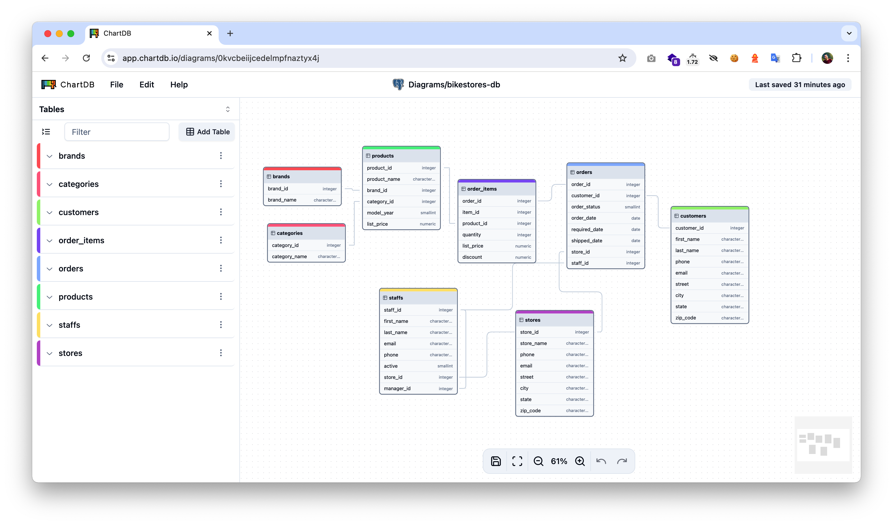

# DraftDB — Front

Éditeur web de diagrammes de bases de données, front du projet **DraftDB**.

Ce dépôt est un fork de [ChartDB](https://github.com/chartdb/chartdb) v1.20.1 (licence AGPL-3.0). Il garde toutes les fonctionnalités de ChartDB et ajoute un **mode API** qui relie l'éditeur au back DraftDB (FastAPI) : les projets, les tables et les imports de dump sont enregistrés côté serveur.

<p align="center">
  
</p>

## Sommaire

- [Fonctionnalités](#fonctionnalités)
- [Deux modes de fonctionnement](#deux-modes-de-fonctionnement)
- [Démarrage rapide](#démarrage-rapide)
- [Configuration](#configuration)
- [Mode API DraftDB](#mode-api-draftdb)
- [Scripts npm](#scripts-npm)
- [Docker](#docker)
- [Structure du projet](#structure-du-projet)
- [Limites connues](#limites-connues)
- [Contribuer](#contribuer)
- [Licence](#licence)

## Fonctionnalités

### Héritées de ChartDB

- **Import de schéma** depuis une base existante via une « Smart Query » (résultat JSON à coller), ou depuis un script SQL DDL ou DBML.
- **Édition visuelle** sur un canevas : tables, vues, colonnes, index, clés primaires et étrangères, relations, contraintes CHECK, types personnalisés, zones et notes.
- **Export** en SQL (par dialecte), DBML, JSON et image (PNG, JPG, SVG). Export DDL vers un autre dialecte assisté par IA, en option.
- **Annuler / rétablir**, filtres d'affichage, mise en page automatique, thème clair ou sombre.
- **Interface traduite** en 22 langues, dont le français.
- **Bases prises en charge** : PostgreSQL (dont Supabase et Timescale), MySQL, MariaDB, SQL Server, SQLite (dont Cloudflare D1), CockroachDB, ClickHouse, ainsi qu'un type générique.

### Ajoutées par DraftDB (mode API)

| Fonctionnalité | Accès dans l'interface | Appel au back |
| --- | --- | --- |
| **Créer un projet** (CU 1.1) | « Nouveau diagramme » | `POST /api/projets` |
| **Ouvrir un projet** (CU 1.6) | URL `/diagrams/<id_projet>`, « Ouvrir », dernier projet ouvert | `GET /api/projets/{id}` |
| **Ajouter une table ou une vue** (CU 2.1) | Barre latérale, clic droit sur le canevas | `POST /api/projets/{id}/tables` |
| **Supprimer une table** (CU 2.3) | Menu de la table, liste latérale, touche Suppr | `DELETE /api/projets/{id}/tables/{id_table}` |
| **Importer un dump SQL** (CU 1.5) | Menu Actions → Importer → « Dump SQL (serveur) » | `POST /api/projets/{id}/import` |

Le détail de chaque parcours est donné dans la section [Mode API DraftDB](#mode-api-draftdb).

## Deux modes de fonctionnement

Le mode dépend de la variable `VITE_API_URL`, lue au moment du build (ou du lancement de `npm run dev`).

| | Mode local | Mode API |
| --- | --- | --- |
| Condition | `VITE_API_URL` vide ou absente | `VITE_API_URL` renseignée (`/` suffit) |
| Stockage | Navigateur uniquement (IndexedDB) | Back DraftDB, plus une copie dans le navigateur |
| Comportement | Celui de ChartDB d'origine | Création et ouverture de projet, ajout et suppression de table, import de dump passent par le serveur |

## Démarrage rapide

Prérequis : **Node.js 24** (voir `.nvmrc`) et npm.

```bash
npm install
npm run dev
```

L'application est disponible sur `http://localhost:5173`. Sans fichier d'environnement, elle démarre en mode local.

Pour utiliser le mode API, le back DraftDB doit tourner (par défaut sur `http://localhost:8000`) :

```bash
cp .env.example .env.local   # puis adapter les valeurs si besoin
npm run dev                  # les requêtes /api sont transmises au back par le proxy Vite
```

## Configuration

Les variables se placent dans `.env.local`, qui n'est pas versionné. Le modèle est `.env.example`.

### Mode API

| Variable | Rôle | Valeur par défaut dans `.env.example` |
| --- | --- | --- |
| `VITE_API_URL` | Active le mode API. Garder `/` : les appels passent par le proxy (même origine), car le back n'active pas CORS. | `/` |
| `API_PROXY_TARGET` | Cible du proxy Vite pour `/api` (`npm run dev` et `npm run preview`). Non exposée au navigateur. | `http://localhost:8000` |
| `VITE_USER_ID` | **Provisoire**, en attendant l'authentification. UUID envoyé dans l'en-tête `X-User-Id`. Il doit exister dans la table `utilisateur` du back, sinon le back renvoie 401. | `00000000-0000-0000-0000-000000000001` (concepteur du seed) |

L'identité peut être changée sans rebuild en définissant `localStorage['draftdb_user_id']` dans le navigateur. Cette valeur passe avant `VITE_USER_ID`. Le relecteur du seed a l'UUID `00000000-0000-0000-0000-000000000002`.

### IA et options héritées de ChartDB

| Variable | Rôle |
| --- | --- |
| `VITE_OPENAI_API_KEY` | Clé OpenAI pour l'export DDL assisté par IA |
| `VITE_OPENAI_API_ENDPOINT` + `VITE_LLM_MODEL_NAME` | Serveur d'inférence compatible OpenAI (vLLM…) à la place d'une clé OpenAI |
| `VITE_DISABLE_ANALYTICS` | `true` pour désactiver les statistiques Fathom |
| `VITE_HIDE_CHARTDB_CLOUD` | `true` pour masquer les liens vers ChartDB Cloud |

Pour l'IA, choisir **soit** une clé OpenAI, **soit** un endpoint avec un nom de modèle, pas les deux.

## Mode API DraftDB

### Créer un projet (CU 1.1)

- « Nouveau diagramme » ouvre un formulaire à la place de l'assistant ChartDB : **nom** (obligatoire, 100 caractères max) et **description** (facultative, 500 caractères max). Le dialecte n'est pas demandé, le projet est de type générique.
- Après la réponse du serveur, l'éditeur s'ouvre sur `/diagrams/<id_projet>` avec un schéma vide. **L'UUID du projet sert d'identifiant au diagramme.**
- Si l'appel échoue (réseau, 401, 422…), rien n'est créé en local et un message d'erreur s'affiche.

### Ouvrir un projet (CU 1.6)

- Quand l'éditeur ouvre un diagramme dont l'id est un UUID, il charge le projet depuis le serveur avec `GET /api/projets/{id_projet}`. Cet appel ne fait que lire. C'est le cas en arrivant sur `/diagrams/<id_projet>`, en ouvrant un diagramme depuis « Ouvrir », ou au lancement, quand le dernier projet ouvert est rechargé. Un id qui n'est pas un UUID s'ouvre depuis la copie locale, comme dans ChartDB.
- **Le serveur fait foi.** Sa version est écrite dans le navigateur (IndexedDB) d'un seul coup, puis affichée. Les ids et l'ordre des colonnes sont conservés.
- Si la copie locale est identique à la version du serveur, la mise à jour est silencieuse. Si elle diffère (tables, colonnes, index, relations ; les positions et couleurs ne comptent pas), une boîte propose d'**utiliser la version du serveur** ou de **garder la version locale**. Garder la version locale n'écrit rien.
- En cas de 401, 403 ou 404, le projet n'est pas ouvert, même s'il existe une copie locale : un message s'affiche et l'application revient à l'accueil.
- Si le serveur est injoignable, la copie locale s'ouvre quand il y en a une, avec un avertissement. Sinon, l'application revient à l'accueil.
- Le dernier `numero_sequence` reçu est conservé dans `localStorage['draftdb_numero_sequence:<id_projet>']`.

### Ajouter une table ou une vue (CU 2.1)

- Une boîte demande le nom avant l'envoi. Un nom libre est proposé (`table_N` ou `view_N`). Le nom est refusé s'il est vide, s'il dépasse 63 caractères ou s'il existe déjà dans le même schéma (casse comprise, comme le back).
- L'ajout est **bloquant** : la table n'apparaît sur le canevas qu'après la réponse 201. Un second clic pendant l'envoi est ignoré.
- Une table dupliquée reçoit un nom unique (`x_copy`, `x_copy_2`…).
- Un avertissement du serveur (par exemple une table sans clé primaire) s'affiche sans empêcher la création.

### Supprimer une table (CU 2.3)

- La suppression se fait en deux appels. Le premier, sans confirmation, n'écrit rien. Si la table a des liens, le serveur répond 409 avec la liste des clés étrangères et des index concernés. Cette liste s'affiche dans une boîte de confirmation.
- Après confirmation, le second appel supprime la table. Elle n'est retirée du canevas qu'après l'accord du serveur, avec ses relations.
- Cette suppression **ne peut pas être annulée** avec Ctrl+Z, car aucune route du back ne restaure une table.

### Importer un dump SQL (CU 1.5)

- Menu **Actions → Importer → Dump SQL (serveur)**, visible seulement en mode API. Le dialogue accepte un fichier `.sql` et propose deux dialectes : PostgreSQL ou MySQL (détecté automatiquement quand c'est possible).
- **Le fichier est analysé dans le navigateur.** Le serveur ne reçoit jamais le fichier : il reçoit le schéma obtenu, le nom, la taille et le dialecte du fichier, et un rapport des instructions non reprises (numéro de ligne, type et raison, sans le texte des instructions). Les lignes propres au client `psql` (`\connect`, `\restrict`…) sont ignorées avant l'analyse.
- Si le projet contient déjà des tables, le serveur répond 409 et l'interface demande de confirmer le remplacement. L'état précédent reste dans l'historique côté serveur.
- Après l'import, le dialogue affiche le nombre d'éléments créés et le rapport des instructions non reprises (200 lignes au plus). Si le serveur a bien importé mais que l'affichage local échoue, un message demande de recharger la page, sans réimporter le fichier.

### Erreurs

Les erreurs du serveur s'affichent dans une notification : réseau injoignable, 401 (utilisateur inconnu), 403, 404, 413 (dump trop gros), 422. Pour un 422, le message exact du back est affiché.

## Scripts npm

```bash
npm run dev            # serveur de développement Vite (avec proxy /api)
npm run build          # lint + vérification TypeScript + build de production dans dist/
npm run preview        # sert le build localement (avec proxy /api)
npm run lint           # ESLint, aucun avertissement toléré (lint:fix pour corriger)
npm test               # Vitest en mode watch
npm run test:ci        # Vitest en une passe (utilisé par la CI)
npm run test:coverage  # couverture de tests
```

Un hook Husky lance `npm run lint` avant chaque commit. La CI GitHub Actions (`.github/workflows/ci.yaml`) lance le lint, le build et les tests.

## Docker

```bash
docker build -t draftdb-front .
docker run -p 8080:80 draftdb-front
```

L'application est servie par nginx sur `http://localhost:8080`.

> **Attention :** l'image Docker actuelle démarre en **mode local**. Le `Dockerfile` ne transmet pas `VITE_API_URL` au build, et la configuration nginx (`default.conf.template`) ne redirige pas `/api` vers le back. Pour un déploiement en mode API, il faut construire le front avec `VITE_API_URL=/` et placer devant un reverse proxy qui transmet `/api/` au back.

Options IA à l'exécution (héritées de ChartDB) :

```bash
# Clé OpenAI
docker run -e OPENAI_API_KEY=<CLE> -p 8080:80 draftdb-front

# Serveur d'inférence personnalisé
docker build \
  --build-arg VITE_OPENAI_API_ENDPOINT=<ENDPOINT> \
  --build-arg VITE_LLM_MODEL_NAME=<MODELE> \
  -t draftdb-front .
docker run -e OPENAI_API_ENDPOINT=<ENDPOINT> -e LLM_MODEL_NAME=<MODELE> -p 8080:80 draftdb-front
```

Les statistiques se désactivent avec `-e DISABLE_ANALYTICS=true` au lancement, ou `--build-arg VITE_DISABLE_ANALYTICS=true` au build.

## Structure du projet

```
src/
├── lib/api/          # Mode API : client HTTP commun, projets, tables, import de dump
├── lib/domain/       # Modèle métier (diagramme, tables, colonnes, relations, règles de nommage)
├── lib/data/         # Import/export SQL (dont l'analyse des dumps et leur rapport)
├── context/          # État global (diagramme courant, dialogues, stockage IndexedDB…)
├── dialogs/          # Boîtes de dialogue (création de projet, nom de table, import de dump…)
├── hooks/            # Hooks React (dont useDeleteTable, useTableNamePrompt)
├── pages/            # Pages routées, dont l'éditeur (editor-page)
├── components/       # Composants UI (shadcn/ui, Radix UI)
└── i18n/locales/     # Traductions (en.ts est la référence, fr.ts est à jour)
```

Stack : React 18, TypeScript, Vite 7, Tailwind CSS, shadcn/ui, React Flow (`@xyflow/react`), Monaco, Dexie, i18next, Vitest.

## Limites connues

Cette première version n'expose qu'une partie des parcours prévus :

- Il n'y a pas encore de liste des projets du serveur. La boîte « Ouvrir » ne montre que les diagrammes déjà présents dans le navigateur. Pour ouvrir un autre projet, il faut aller sur son URL `/diagrams/<id_projet>`.
- En mode API, seules les actions listées plus haut passent par le serveur. Les autres modifications (colonnes, relations, renommage, position des tables…) restent dans le navigateur. À la prochaine ouverture, elles déclenchent la boîte « copie locale / serveur ».
- L'identité est provisoire (`VITE_USER_ID` / en-tête `X-User-Id`), en attendant l'authentification.
- L'image Docker ne gère pas encore le mode API (voir [Docker](#docker)).

## Contribuer

- Une branche et une pull request par modification, vers `develop`.
- Lancer `npm run lint` et `npm run test:ci` avant d'ouvrir une PR.
- Conventions de code et règles de travail : voir [`CLAUDE.md`](CLAUDE.md) et [`CONTRIBUTING.md`](CONTRIBUTING.md).

## Licence

Ce projet est distribué sous licence [GNU Affero General Public License v3.0](LICENSE), comme ChartDB dont il est dérivé. Code d'origine : [chartdb/chartdb](https://github.com/chartdb/chartdb), © ChartDB.
